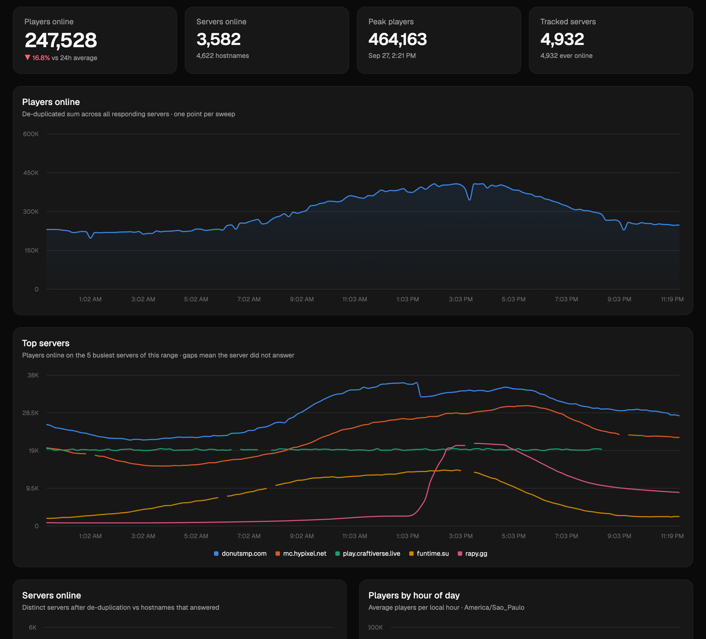

# Minecraft Server Census

[](https://github.com/lucaazalim/minecraft-server-census/actions/workflows/ci.yml)
[](LICENSE)
[](https://census.azal.im)

**How many people are playing Minecraft Java Edition right now, and where?** This project pings thousands of public Minecraft servers every 10 minutes, counts each server once even when it hides behind a dozen hostnames, and puts the results on a public dashboard.

**See it live at [census.azal.im](https://census.azal.im).**



## Features

- **Live and historical player counts**: players online now and over time, peaks, and hour-of-day / weekday profiles shown in your local time.
- **Honest totals**: hostnames that are really the same server (`mc.example.com`, `play.example.com`, `example.net`…) are detected and counted once, and every merge shows its evidence.
- **Per-country views**: filter every chart by country (ccTLD, GeoIP, or a manual override).
- **A page per server**: colour-rendered MOTD, player history with outages, which client versions it accepts (1.8 to latest), software and mods, DNS/GeoIP details, and whether it is on Mojang's blocklist.
- **Small and self-contained**: one Node.js process with no native modules. SQLite is Node's built-in `node:sqlite`, HTTP is `node:http`, pings are raw TCP. It runs on a 1 GB / shared-CPU VM.

## Quick start

Requires **Node.js 24** (22.13+ works).

```bash
git clone https://github.com/lucaazalim/minecraft-server-census.git
cd minecraft-server-census
npm install
npm run dev     # collector + API on :8080 and the dashboard with hot reload on :5173. Open the Vite URL
```

On first start the server lists in [`data/seeds/`](data/seeds) are imported into a fresh SQLite database under `data/db/`, and the first sweep starts right away. The charts fill in as sweeps accumulate. To try the protocol code without the dashboard:

```bash
npm run ping -- mc.hypixel.net      # one Server List Ping, pretty-printed
npm test                            # node:test suites
```

See [Run locally](#run-locally) for the production build and the operator CLI, and [Configuration](#configuration-env-vars) for every knob.

## How it works, in short

1. **Sweep**: every 10 minutes every tracked server gets a [Server List Ping](https://minecraft.wiki/w/Java_Edition_protocol/Server_List_Ping) (SRV records and legacy pre-1.7 servers included). The whole status reply is stored.
2. **De-duplicate**: hostnames that answered are grouped by shared players, shared IP:port or DNS targets, and identical favicon/MOTD, but only when their player counts agree ([details](#de-duplication-counting-each-server-once)).
3. **Aggregate**: per-sweep totals (overall and per country) are written, and per-server history is rolled up hourly so long ranges stay cheap.
4. **Serve**: a read-only JSON API and the React dashboard are served from the same process. Queries run on a reader thread and are cached per sweep.

Servers only enter the database through the seed files or the CLI. There is no automatic discovery, and the site has no login, write endpoint or export.

## Contributing

Issues and pull requests are welcome, especially new seed servers, de-duplication edge cases, and dashboard improvements.

- Read [`AGENTS.md`](AGENTS.md) before changing code. It covers the layout, conventions and gotchas (SQL safety, schema migrations, the read-only API, performance rules for the `pings` table).
- `npm run typecheck && npm test` must pass. UI changes should also pass `npm run build` and be checked at desktop and phone width in both themes.
- To suggest servers, add `host[:port]  # note` lines to a file in [`data/seeds/`](data/seeds). Bare IPs are skipped.

## License

[MIT](LICENSE) © Luca Azalim. This project is not affiliated with Mojang or Microsoft. "Minecraft" is a trademark of Mojang Synergies AB. Player counts are self-reported by each server.

---

## In depth

The rest of this README documents the internals: what gets stored, the de-duplication rules, the operator CLI, configuration and deployment.

The site is read-only: there is no login, no write endpoint and no export. Operators add servers and adjust de-duplication from the CLI. The site name lives in `src/web/lib/site.ts` (plus `src/web/index.html` and this file), so it can be renamed in one place.

## Repository layout

```
src/server/     collector, scheduler, protocol code, read-only JSON API (src/server/api/*), CLI
src/web/        dashboard (Vite + React 19 + Tailwind v4 + shadcn/ui on Base UI + Recharts)
test/           node:test suites (dedup rules, blocklist, scope parsing, per-country aggregates, static serving, MOTD parser)
data/seeds      hand-curated host lists imported at start; data/db holds the SQLite file (git-ignored)
```

## What it collects

| Table              | Content                                                                                                                                                             |
| ------------------ | ------------------------------------------------------------------------------------------------------------------------------------------------------------------- |
| `servers`          | one row per host:port, with DNS/SRV resolution, GeoIP (country, city, ISP/ASN), rolling status, peak, favicon                                                       |
| `sweeps`           | one row per 10-minute sweep: hostnames attempted/online, distinct servers after de-duplication, players online (raw and de-duplicated)                              |
| `sweep_countries`  | the same totals per country for every sweep (source of every country-scoped chart)                                                                                  |
| `pings`            | one row per server per sweep: ok/error, latency, players online/max, protocol, version name, sample size, real player UUIDs from the sample, duplicate group + rule |
| `status_snapshots` | every _distinct_ status payload per server (MOTD, version, max players, Forge mod list, chat flags, unknown keys, raw JSON)                                         |
| `version_probes`   | daily probe: for each server and each client protocol (1.8.9 … latest), did the server accept that version?                                                         |
| `blocked_servers`  | tracked servers that are on Mojang's server blocklist, with the pattern that matched (`blocklist` holds the raw SHA-1 list)                                         |

Ping details:

- Modern SLP (1.7+) with protocol `-1`, so the server reports its native version. If that answer carries no player count (`online: 0, max: 0` or no `players` at all: version-gate and anti-VPN plugins answer unknown protocols with a placeholder), the ping is repeated once with the newest known protocol and that status is kept when it has a count. Legacy `0xFE 0x01` fallback for pre-1.7 servers.
- SRV records (`_minecraft._tcp`) are honoured, and the SRV target goes in the handshake like the vanilla client does.
- Version support is measured separately: once a day each online server is pinged once per protocol in `PROBE_PROTOCOLS`; ViaVersion/proxy servers echo the protocol back when they accept it.
- Failing servers back off automatically (never-online hosts hourly, then every 6 h) so dead entries do not eat the sweep budget.
- Country = the operator's override if one was set (`npm run country`), else the hostname's ccTLD (`.br`, `.de`, …; vanity ccTLDs like `.io`, `.gg`, `.me` do not count), else the GeoIP country of the resolved IP (ip-api.com, free tier, 1 batch request per ~4 s). The ccTLD wins over GeoIP because it says who a server is _for_ while the IP only says where it is hosted: Brazilian communities on OVH Canada or US hosts are still Brazilian. `sweep_countries` is filled at the end of every sweep and **backfilled on first start** for older sweeps; the backfill, `npm run regroup` and `npm run country` use each server's _current_ country, so history is always attributed to today's country.

## Mojang's server blocklist

The vanilla client refuses to connect to servers on [Mojang's blocklist](https://sessionserver.mojang.com/blockedservers) (EULA / illegal-content enforcement). The list is only SHA-1 hashes, but we know the addresses we track, so `src/server/blocklist.ts` hashes each server's candidates the way the client does — lowercase, no port, the address itself plus one wildcard per level (`mc.example.com`, `*.example.com`, `*.com`; `1.2.3.4`, `1.2.3.*`, `1.2.*`, `1.*`) for the typed hostname, the SRV target and the resolved IP — and looks them up. The list is re-downloaded every `BLOCKLIST_INTERVAL_HOURS` and every server is re-checked after each sweep. Blocked servers get a **Blocked** badge in the list and a card on their page with the matching pattern; they still count towards the totals (they are reachable with a modified client), so excluding them is a judgment call for the analysis (`npm run blocklist` lists them).

## De-duplication (counting each server once)

Server lists are full of aliases: `mush.com.br`, `jogar.mush.com.br`, `bra12.mush.com.br` and `jogar.mushmc.com.br` are one server. Neither DNS nor status metadata alone can tell: big networks spread one player pool over several IPs and SRV ports, while hostname-routed proxies (TCPShield, DDoS shields, Aternos, Falix…) put dozens of _unrelated_ servers on one IP:port. So at the end of every sweep (`src/server/dedup.ts`) the hostnames that answered are grouped by rules that combine a _link_ with _corroboration from the status itself_, mainly "player counts agree" (within `DEDUP_TOLERANCE_PCT`, floor 3 players):

| rule          | merges two hostnames when…                                                                                             |
| ------------- | ---------------------------------------------------------------------------------------------------------------------- |
| `sample`      | the same real player (v4 UUID + name) appears in both player samples                                                   |
| `endpoint`    | they share an IP:port (all SRV × all A records seen in 24 h) **and** counts agree **and** same favicon, MOTD or domain |
| `dns`         | they share a CNAME / SRV target **and** counts agree **and** same favicon or MOTD                                      |
| `fingerprint` | identical favicon, MOTD and max players **and** counts agree (no shared address; networks behind several IPs)          |

Servers under 10 players must look identical (favicon **and** MOTD) — that is where hosting providers put many customers behind one address and tiny counts agree by accident. Groups are transitive (union-find). Sweep totals sum the **maximum** count of each group; `players_online_raw` keeps the naive sum. The rule that linked each hostname is stored on `pings.group_reason` (history) and `servers.group_reason` (current). Every server page shows its group: each member, the rule that merged it and the evidence (shared endpoints / DNS targets, same favicon, same MOTD, same domain, player-count delta), plus the hostnames on the same IP:port that were deliberately _not_ merged.

The dashboard is read-only and there are no manual merge overrides: wrong merges are fixed by changing the rules, then `npm run regroup` recomputes every sweep's groups, totals and per-country rows.

## Run locally

```bash
npm install
npm run dev                 # backend (collector + API on :8080, restarts on change) + Vite dev server with hot reload (:5173, proxies /api)
npm run dev:server          # backend only; npm run dev:web for Vite only
```

Production mode (one process serving everything from memory):

```bash
npm run build               # tsc -> dist/server/, vite -> dist/web/
npm start                   # http://localhost:8080
```

`npm run typecheck` covers backend and frontend, `npm test` runs the node:test suites (including the MOTD parser shared with the web app).

Operator CLI (the only write path):

```bash
npm run add -- mc.example.com play.other.net:25566        # track more servers (also lifts a `remove` deny entry)
npm run remove -- mavenmc.net --reason "fake player count"  # delete a server + all its data; deny-listed so scrapes don't re-add it
npm run suspects                                          # hostnames that look like they inflate their player count (review, then remove)
npm run country -- jogarbrasilcraft.com --set BR          # pin a server's country over ccTLD/GeoIP (recomputes every sweep's per-country totals)
npm run country -- jogarbrasilcraft.com --clear           # back to ccTLD, then GeoIP
npm run ping -- mc.mush.com.br                            # one ping, pretty-printed (--protocol 47 --raw)
npm run probe -- mc.mush.com.br                           # which client versions does it accept?
npm run discover [-- --countries BR,US --out FILE]        # scrape list sites, write untracked addresses to data/discovered.txt for review (adds nothing)
npm run sweep                                             # one full sweep
npm run groups -- --scope BR                              # print duplicate groups of the last sweep
npm run regroup                                           # recompute groups + totals for every sweep
npm run prune -- --min-pings 3 --min-age-hours 24         # delete IP hosts + servers never online after 3 pings over 24h (deny-listed; --no-deny to skip)
npm run prune -- --min-pings 1 --min-age-hours 0 --recheck 3   # same, but ping every candidate up to 3 times first and keep the ones that answer
npm run blocklist [-- mc.example.com]                     # refresh Mojang's blocklist / test one address
npm run compact                                           # slim old ping rows now; the next server start shrinks the file (see below)
npm run thin -- --minutes 10 [--dry-run]                  # keep the first sweep of every 10-minute slot, delete the rest with their pings
```

Seeds live in `data/seeds/*.txt` (`host[:port]  # note`) and are the only way servers enter the database (besides `npm run add`). They are re-imported at every start (idempotent), so adding a line and redeploying is enough. Bare IPs are skipped because they are almost always hobby servers, not the market; `TRACK_IP_HOSTS` turns that off.

There is no automatic discovery: `npm run discover` scrapes eight server-list sites (minecraft-mp.com, minecraftservers.org, minerank.com, minecraft.buzz, minecraftlist.org, topg.org, minecraftiplist.com, best-minecraft-servers.co) for every country in `DISCOVERY_COUNTRIES` (or `--countries`) plus minecraft-mp.com's global "most played" ranking, and writes the addresses that are neither tracked nor deny-listed to `data/discovered.txt` in seed-file format, grouped by source. Review them (`npm run ping -- <addr>`) and copy the keepers into a seed file; the scrape itself adds nothing. The per-site URL slugs live in `src/server/discovery/sources.ts` (`COUNTRIES`); add a row there to support another country.

## Configuration (env vars)

| Var                                                                     | Default                                    | Meaning                                                                                                                                   |
| ----------------------------------------------------------------------- | ------------------------------------------ | ----------------------------------------------------------------------------------------------------------------------------------------- |
| `PORT` / `HOST`                                                         | `8080` / `0.0.0.0`                         | HTTP server                                                                                                                               |
| `DATA_DIR`                                                              | `./data/db`                                | where `census.db` lives (mount a volume here)                                                                                             |
| `SEEDS_DIR`                                                             | `./data/seeds`                             | seed files imported at boot                                                                                                               |
| `PUBLIC_DIR`                                                            | `./dist/web`                               | built dashboard to serve                                                                                                                  |
| `PING_INTERVAL_MINUTES`                                                 | `10`                                       | sweep cadence                                                                                                                             |
| `PING_CONCURRENCY`                                                      | `64`                                       | parallel pings                                                                                                                            |
| `PING_TIMEOUT_MS`                                                       | `6000`                                     | per-connection timeout                                                                                                                    |
| `PING_PROTOCOL`                                                         | `-1`                                       | protocol number sent in the sweep handshake; `-1` makes servers report their native version                                               |
| `DNS_SERVERS`                                                           | `1.1.1.1,8.8.8.8`                          | resolvers for SRV/A/CNAME lookups; `system` uses the OS resolver list (which often chokes on bursts, e.g. Tailscale MagicDNS)             |
| `DNS_TIMEOUT_MS` / `DNS_TRIES`                                          | `4000` / `2`                               | per-query resolver timeout and retries (on top of `PING_TIMEOUT_MS`, which covers only the TCP part)                                                                |
| `DNS_CACHE_MINUTES` / `DNS_NEGATIVE_CACHE_MINUTES`                      | `20` / `5`                                 | how long a successful / failed resolution is reused                                                                                       |
| `PROBE_ENABLED` / `PROBE_INTERVAL_HOURS` / `PROBE_PROTOCOLS`            | `true` / `24` / see `src/server/config.ts` | version-support probe                                                                                                                     |
| `PROBE_CONCURRENCY` / `PROBE_TIMEOUT_MS` / `PROBE_HANDSHAKE_DELAY_MS`   | `16` / `5000` / `150`                      | servers probed in parallel; per-handshake timeout; pause between handshakes to the same server                                            |
| `PROBE_INITIAL_DELAY_MINUTES` / `PROBE_ONLINE_WITHIN_HOURS`             | `20` / `24`                                | wait after boot before the first probe; only servers seen online this recently are probed                                                 |
| `DISCOVERY_COUNTRIES`                                                   | `US,BR,DE,GB,FR,RU,PL,ES,CA,TR`            | ISO codes whose list-site pages `npm run discover` scrapes (supported set: `COUNTRIES` in `src/server/discovery/sources.ts`)              |
| `DISCOVERY_PAGE_DELAY_MS`                                               | `1500`                                     | pause between page fetches of one list site                                                                                               |
| `GEOIP_ENABLED`                                                         | `true`                                     | ip-api.com lookups                                                                                                                        |
| `GEOIP_BATCH_SIZE` / `GEOIP_BATCHES_PER_SWEEP` / `GEOIP_BATCH_DELAY_MS` | `100` / `6` / `4500`                       | IPs per request (ip-api.com allows 100); requests per lookup pass (one pass after each sweep); pause between requests (free tier: 15/min) |
| `GEOIP_CACHE_DAYS`                                                      | `7`                                        | re-geolocate a server's IP after this long                                                                                                |
| `BLOCKLIST_ENABLED` / `BLOCKLIST_INTERVAL_HOURS`                        | `true` / `6`                               | flag servers on Mojang's blocklist; how often the list is re-downloaded                                                                   |
| `DEDUP_TOLERANCE_PCT`                                                   | `5`                                        | two hostnames whose player counts differ by more than this are never merged                                                               |
| `TRACK_IP_HOSTS`                                                        | `false`                                    | also track bare `IP:port` addresses (hobby servers; skipped from seeds and scrapes by default)                                            |
| `RETENTION_DAYS`                                                        | `0` (keep all)                             | drop raw `pings` rows older than this; the hourly per-server history (`server_hours`) and sweep totals are kept, so charts past 72 h are unaffected |
| `LOG_LEVEL`                                                             | `info`                                     | `debug` / `info` / `warn` / `error`                                                                                                       |

## Deploy to Fly.io (São Paulo)

The public instance runs at <https://census.azal.im> (Fly app `mc-server-census`, region `gru`). [`.github/workflows/ci.yml`](.github/workflows/ci.yml) runs typecheck, tests and the build on every pull request and push. Pushes to `main` of this repository then run `fly deploy --ha=false` with the `FLY_API_TOKEN` repository secret (a Fly deploy token). Forks skip the deploy job.

To run your own instance, pick a free app name in `fly.toml` (`fly apps create <name>`), create the volume, and deploy:

```bash
fly auth login
fly volumes create mcdata --region gru --size 10
fly deploy --ha=false                           # ONE machine: two machines would double-ping and split the data
fly status
fly logs
```

Notes:

- `fly.toml` mounts the volume `mcdata` at `/data` (`initial_size = "10gb"`), pins the region to `gru`, and sets `auto_stop_machines = "off"` so the collector never sleeps.
- `fly.toml` only sets `DATA_DIR=/data`; every other knob runs at its default from the table above. Override with `fly secrets set` or an `[env]` entry only when the value should differ from the default.
- Keep it at exactly one machine (`fly scale count 1`). The SQLite file lives on that machine's volume.
- A week of data for ~5 000 servers is roughly 10 M ping rows. Rows written since the storage slimming take ~100 bytes each including the one index (older rows ~190), about 1 GB a week; the 10 GB volume holds months, and `RETENTION_DAYS` bounds it if needed (hourly history is kept).
- Shrinking the database file: freed pages are reused by new rows, so the file only needs compacting after large deletions or schema slimming. `fly ssh console --user node -C "sh -c 'cd /app && node dist/server/cli.js compact'"` rewrites old ping rows while the collector runs (resumable), then `fly machine restart` makes the next start run `VACUUM INTO` + `quick_check` and swap the copy in before the collector and dashboard start (minutes of downtime; a temporary `fly machine update --vm-size performance-1x` triples the volume bandwidth). The previous file stays as `/data/census.db.pre-compact` until you delete it; the space is freed only then.
- `shared-cpu-1x` gets 6.25% of a CPU on average (burst balance up to 500 s), so the process is built to stay idle between sweeps: dashboard queries run on a reader thread and are cached per sweep, and nothing scans the pings table on a request.
- To grab the data: `fly ssh sftp get /data/census.db` (the site itself is read-only and exposes no exports).

## Dashboard / API

`/` is the dashboard, `/server/<host[:port]>` the page of one server; any other path is a 404 (there are no write endpoints, no exports and no authentication). JSON endpoints, all `GET`, `scope` = `all` or an ISO country code:

| Endpoint                                                                     | Returns                                                                                                               |
| ---------------------------------------------------------------------------- | --------------------------------------------------------------------------------------------------------------------- |
| `/api/health`                                                                | liveness + sweep/probe state                                                                                          |
| `/api/overview?scope=`                                                       | KPIs of the last sweep (players, distinct servers, peak, tracked), collector status, servers per source                |
| `/api/timeseries?scope=&hours=`                                              | players/servers per sweep (≤ 72 h), hourly buckets (≤ 31 d) or 6-hour buckets; `hours=0` = everything                 |
| `/api/profile?scope=&days=`                                                  | average/max players per UTC weekday × hour (the client shifts to local time)                                          |
| `/api/versions?scope=` · `/api/software?scope=` · `/api/probes?scope=`       | breakdowns over distinct servers online                                                                               |
| `/api/countries`                                                             | servers, distinct servers online and players per country                                                              |
| `/api/servers?q=&scope=&status=online\|offline\|all&sort=&dir=&page=&limit=` | one row per distinct server; with `q`, aliases are included and marked                                                |
| `/api/server/<host[:port]>?hours=`                                           | everything about one server: status, history, probes, snapshots, blocklist, duplicate group with evidence, neighbours |
| `/api/servers/:id/favicon`                                                   | favicon image                                                                                                         |

## Caveats

- Player counts are self-reported by servers; some inflate them. The recurring trick is one vanity hostname per list site (`ms.`, `sm.`, `buzz.`, `best.`…), each answering with a different, larger number than the address players use — and because the counts disagree, de-duplication cannot merge them, so the server is counted several times. `npm run suspects` groups hostnames by favicon + MOTD and lists the ones whose counts disagree, plus servers reporting more players than slots; `npm run remove` deletes and deny-lists the inflated hostnames. `status_snapshots` and the players sample help judge the rest.
- De-duplication is rule-based (see above) and can be wrong in both directions; the server pages show the evidence for every merge. Hosting providers' placeholder statuses (Aternos "sleeping" pages, Minehut lobbies reporting the whole platform's count) are counted as one server each but are not real player pools — check the MOTD.
- Country = operator override, else ccTLD, else GeoIP of the server IP. Communities hosted abroad (Miami/Virginia and OVH Canada are common for Brazilian servers) show under the hosting country unless the hostname ends in a ccTLD or the operator pins them with `npm run country`; a Portuguese MOTD on a `.com`/`.net` host is the usual tell. The server page shows both the country and where the server is hosted.
